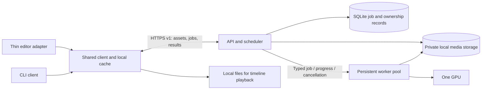

# Shared CorridorKey service proposal

**Status: private API pilot implemented, 2026-10-24.** See [deployment guide](pilot.md)
and [measured results](pilot-results.md). [Editor inputs](editor-inputs.md) now add
qualified hints, sparse corrections, masks and linear EXRs; see their
[qualification](editor-input-results.md). Editor integrations remain future work.
Start with one host, a versioned HTTP contract, a durable bounded queue, and a
configurable pool of persistent inference workers. Start one worker. Two 720p
workers are qualified for exactness on the roughly
22 GiB GPU; 1080p jobs run exclusively, including with two resident models.
Many clients can upload, submit and poll independently of the active worker count.

- [Inspected implementation and measurements](current-state.md)
- [API contract](api.md) and [OpenAPI schemas](openapi.json)
- [Scaling and vLLM / llama.cpp assessment](scaling.md)
- [Prepared private footage and Mac latency client](../../benchmarks/api/README.md)
- [CLI-first milestone](#cli-first-milestone)

## Components and boundaries

The editor adapter exports a defined source range, submits a recipe, and imports
verified local results. It owns timeline mapping, host colour transforms and
host-specific alpha interpretation. After Effects, Premiere, Resolve/Fusion,
Nuke, Final Cut and Blender share the media/job contract; their SDK integration
is separate work. No host application is assumed to expose the same plugin API.

For public hosting, use an ASGI control service behind TLS; keep PyTorch/CUDA out of its
request processes. SQLite on local disk holds owners, quotas, uploads, immutable
recipes, idempotency records, jobs, worker leases and result metadata. Use WAL,
short write transactions and bounded busy retries. Files live
on the same host's private SSD. One bounded CPU validator handles media inspection.
This fits SQLite's [single-host use](https://www.sqlite.org/whentouse.html).
No distributed broker, Redis, Kubernetes, shared network filesystem or tensor
parallelism is needed for the initial deployment.

The worker interface is internal: `run(resolved_job, progress_sink, cancel_token)`.
It receives server-resolved files and an immutable execution profile; it never
interprets authentication, editor project files, upload URLs or arbitrary client
checkpoint paths. Its implementation wraps `load_model()` and `run_inference()`.
The OpenAPI document must not import worker dataclasses. A future runtime can
implement the same contract with a new execution revision.

Each worker loads one model once and processes jobs serially. Reuse includes
the model's existing CPU/GPU offloading; it does not imply all weights stay on
GPU. Separate workers initially own separate model copies. Before each job,
restore mutable inference attributes, use a fresh configuration and unique
attempt directory, reset seed/state, and restore the pinned execution flags.
After a crash, hard cancellation or uncertain CUDA error, recycle that worker.
Model reuse and callback changes must pass the existing exact-output suite.

## Scheduling and resource admission

Initial policy proposal: one active GPU job, eight pending jobs globally, at
most two pending jobs per user, and at most one active job per user. Round-robin
users, FIFO within each user. Preview jobs use the same fairness policy and do
not preempt a running full job. Limits apply equally to sponsors and everyone else.
Two-worker qualification may raise global active jobs to two, with separate users
running concurrently; a request for more concurrency must still pass admission.

Reserve upload bytes at asset creation and estimated output/scratch bytes before
job acceptance. Bound validation concurrency, decoded pixels/frames, CPU threads,
host RAM and disk as well as VRAM. A 4 GiB input-asset limit and 16 GiB per-user
media quota are current pilot policy, not measured model limits. Overall disk
budget/free-space floor are configured from the deployment disk. Advertise all
effective limits. Reject overload with `429` and `Retry-After`; never silently
shrink frames/windows or change precision to make a request fit.

Claim jobs atomically with an attempt ID and fencing generation. Use a GPU
process lock, heartbeat and lease; do not launch a replacement CUDA worker merely
because a heartbeat expired while the old process may still own the GPU. The
supervisor must terminate/reap that process group first. Stagger model loading.
An attempt writes private files, closes writers, checks count/hashes and fsyncs,
then renames into immutable storage. A fenced database update publishes the
manifest. Downloads require the published DB record. Crash-created orphan files
are collected; a stale attempt cannot publish or overwrite a newer result.

## Time, colour and quality

Frame ranges are zero-based, start-inclusive/end-exclusive in presentation order.
PTS and durations are integer tick strings with a rational time base; frame rate
is rational, never rounded to a display FPS. Original timecode is optional metadata,
not a frame identifier. Preserve source PTS origins; editors map them into their
own sequence/timeline. Reject VFR, interlaced, non-square-pixel and rotated inputs
in the first milestone rather than silently retiming or reorienting them.

The first contract supports an entire asset as inference context, with a separate
requested output range. Process the complete context with the same windows and
batching, then select output frames. RVM state, carried hints and end-window
placement make a simple fixed number of handles insufficient to promise full-shot
equality. If the client uploads only a selection, that selection is the context;
it is not equivalent to processing its original full shot.

`purpose=preview` initially means a smaller delivered range, with the same native
quality/profile and context as a full job. It may cost as much GPU time on a cold
cache. No draft scaling is advertised. Later trimmed-context or proxy previews
need a separately named, explicitly non-equivalent profile and cache key.

Initial media convention: RGB, BT.709/sRGB primaries, D65, full range, sRGB
transfer for 8-bit PNG input; no input alpha. The model receives the existing
sRGB-to-linear-to-asinh conversion. Deliver separate float32 ZIP EXR foreground
and alpha: foreground is linear with the same primaries; alpha is linear coverage
data, never gamma-transformed. Foreground is straight/unassociated; no extra
despill or premultiplication is introduced. Explicit metadata accompanies files.

Scene-linear RGB EXR half/float input is now qualified, with specified primaries.
ACES, camera log, PQ/HLG, arbitrary YUV ranges, 10/12-bit video and 16-bit PNG need
verified conversion paths before capability enablement. A flag saying "linear"
does not convert ACEScg to the service's RGB space. Reject unrecognised/ambiguous
colour metadata. Thin adapters may export a documented canonical plate; record
their colour-transform identity in the asset digest. Preserve HDR/negative values
in the linear path. Input alpha is rejected initially, not silently discarded.

For hosts requiring premultiplied RGB, derive it locally from canonical linear
foreground × alpha and retain the straight master. Host display transforms and
premultiplication order must be explicit. Half EXR, lossy preview video, despill,
and premultiplied derivatives cannot be represented as byte-identical masters.

## Authentication, storage and local playback

Start with revocable, expiring per-user service bearer tokens issued by a local
admin command. Store token hashes server-side and secrets in the client OS keychain.
Use HTTPS outside loopback, scoped tokens, body/rate limits, and ownership checks
on every asset, upload, job and file operation. Cross-user IDs return 404. No
client-supplied server paths, URL fetching, codecs, shell arguments, pickle files
or model weights. Media decoding runs with restricted filesystem/network access
and resource limits. Use private service-owned directories and restrictive file
permissions. File slots use opaque IDs and validated types; no archive
extraction is needed for the first sequence-upload protocol.

Proposed TTLs: incomplete uploads 24 h from creation; ready assets 24 h after
validation; results 24 h after completion. Accepted jobs pin input storage until
terminal state. Set a maximum queue age and run deadline so pins cannot retain
media indefinitely; use a provisional 10-minute queue age / 10-minute run deadline
for the initial bounded pilot. The editor revision allows 30-minute execution
while retaining the 10-minute queue age. TTLs do not slide on polling. Expiry/deletion
revokes new reads immediately; open transfers are checked between chunks.

Delete-job requests cancel active work, revoke result reads and return a deletion
record. Delete-asset requests additionally cancel dependent jobs and purge their
results. Cleanup waits for process/reader ownership to end and then removes bytes;
report pending/completed/failure honestly. A janitor runs on startup and periodically.
Keep only minimal owner-scoped idempotency tombstones and deletion records for
seven days; no frames,
original filenames or signed URLs in logs/backups. SSD unlinking is not a promise
of forensic secure erasure. Document that users control already downloaded copies.

Results are temporary authenticated, range-downloadable files, not public links.
The client verifies SHA-256 into `.part` files, atomically publishes its local
manifest, and imports complete frames. Cache by source-content digest, context,
output range, colour transforms, recipe and execution fingerprint; partition by
server/account. Keep schema/version metadata beside files. Support local LRU,
pinning project results and explicit local purge. Timeline render callbacks only
read local media; offline playback never calls HTTP. Remote deletion does not
invalidate an intentional local project copy.

## CLI-first milestone

Build the contract and this small loop before an editor plugin:

1. One configured GPU, one persistent worker, one fixed native 24/12 profile,
   Stage 2 batch 1, no hints. Use the accepted model/stack and float EXR alpha/FG.
2. A CLI exports/declares up to 72 RGB8 sRGB PNG frames, at most 1280×720, with
   explicit timing and colour. This is a deliberate pilot limit, not a model maximum.
3. It discovers capabilities, uploads/resumes files, finalises the asset, submits
   preview/full jobs with durable idempotency keys, polls, cancels/retries as needed,
   resumes downloads and verifies local results. The [implemented CLI](pilot.md#connect-and-process-footage)
   covers this loop; the lifecycle runner exercises cancellation, retry and deletion.

4. Compare with direct inference on exactly the same canonical files/profile:
   zero changed alpha/FG values and identical float EXR bytes. A preview subrange
   with the same context must equal those frames from the full result.
5. Interrupt uploads/downloads; replay submissions; test wrong offsets/hashes,
   cross-user access, queue limits, cancellation races, crash/restart, disk failure,
   expiry and deletion. Successful retries publish one manifest, no partial result.
6. Qualify model reuse with A→B→A, repeated short/tail clips, different dimensions,
   low-memory/normal transitions and post-cancellation jobs. Re-run all 602 exactness
   fixtures when worker hooks or reset logic change runtime execution.
7. Run the [one-versus-two worker experiment](scaling.md#qualification-on-the-22-gib-gpu).
   Enable two active sessions only for qualified profile combinations. Add an editor
   adapter once this CLI and concurrency gate work reliably.

The future client SDK owns HTTP/retries/cache, not GPU tensors. Native adapters
may call that library or a local helper process over a narrow IPC interface.

## Decisions still needing measurements

| Decision | Required evidence |
|---|---|
| One or two active workers | Combined throughput, p50/p95 queue and service latency, peak device/RAM use, exact outputs; mixed sizes and cancellation |
| Resident model reuse | Warm/cold jobs, leaks, profile reset, A→B→A equality; loading already costs ~10.69 s on the tested case |
| Preview latency / priority | Same-context cost and cache hit rate; no measured instant-preview path |
| Admission/VRAM profiles | Loading/transient/workspace peaks, cancelled-job recovery, sustained thermals; don't use stale automatic table as a guarantee |
| CPU threads and EXR workers | Repeat under two jobs, uploads/downloads and real disk load; six threads per output was tested for one job |
| 1080p / 4K / HDR / video | Finish clean 1080p timing; new capacity, bit-depth/PTS/colour and exactness qualification for the other paths |
| Storage TTL and longer shots | Output/scratch sizes, host-RAM peaks, bandwidth and user reuse patterns |

## Free service and sponsorship

No billing tiers, sponsor priority, sponsor quotas or sponsor-only models/features.
GitHub sponsorship is optional and separate from authentication and scheduling.
Keep CorridorKey attribution and the existing licence/notices with public derivatives.

The [upstream licence](https://github.com/nikopueringer/CorridorKey2.0/blob/master/LICENSE)
permits voluntary donations and bars paid API access, but also contains restrictions
on repackaging, commercial integrations and large organisations. Free hosting alone
does not resolve every clause; clarify the intended public service/plugin distribution
with the licensor before launch. This is a launch question, not a reason to block
the architecture or private CLI qualification. Third-party weights retain their own
terms, recorded in [THIRD_PARTY_NOTICES.md](../../THIRD_PARTY_NOTICES.md).
