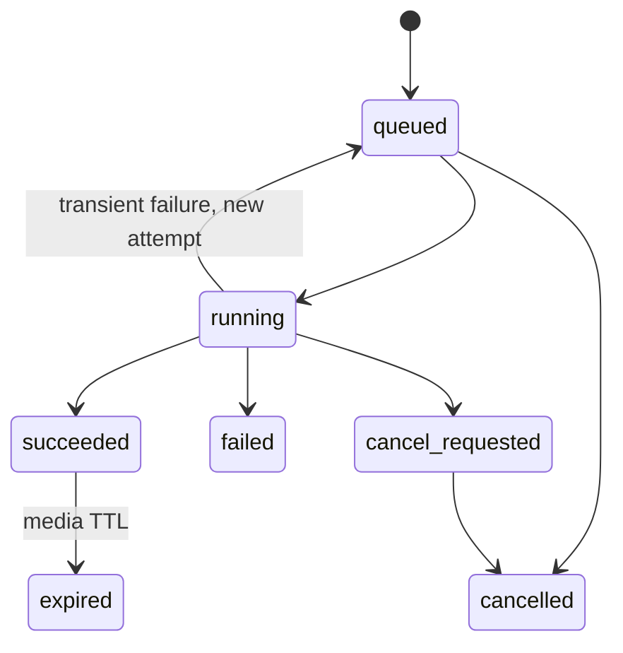

# Proposed HTTP API v1

Design contract, not a deployed service. [OpenAPI](openapi.json) defines the
wire schemas; [architecture](README.md) defines worker and storage behaviour.
The schema is intentionally limited to the first milestone. Future supported
formats/profiles are enabled through capability discovery and additive revisions;
unknown request fields are rejected, and clients ignore unknown response fields.

## Routes

| Method and path | Contract |
|---|---|
| `GET /v1/capabilities` | API/model/execution revisions, profiles, accepted media, outputs, limits, retention and concurrency |
| `POST /v1/assets` | Declare a sequence manifest; allocate immutable file slots and upload URLs; 201 |
| `GET /v1/assets/{asset_id}` | Upload/validation state and canonical metadata |
| `HEAD, PATCH, DELETE /v1/uploads/{upload_id}` | Resume/transfer/abort one file; authenticated tus resources |
| `OPTIONS /v1/uploads/{upload_id}` | tus protocol/extension discovery |
| `POST /v1/assets/{asset_id}/complete` | Freeze uploads and start checksum/media validation; 202 |
| `DELETE /v1/assets/{asset_id}` | Revoke reads, cancel dependants, purge input and derived results; 202 |
| `POST /v1/jobs` | Submit immutable model/profile, asset, context, output range and purpose; 202 |
| `GET /v1/jobs/{job_id}` | State, phase counters, queue information, effective recipe, failure/result links |
| `POST /v1/jobs/{job_id}/cancel` | Queued: 200 cancelled; running: 202 cancel requested; terminal: 200 unchanged |
| `POST /v1/jobs/{job_id}/retry` | New job ID with the same frozen recipe, `retry_of` link; requires retained inputs; 202 |
| `DELETE /v1/jobs/{job_id}` | Cancel active work and purge its results, retaining only minimal tombstone; 202 |
| `GET /v1/deletions/{deletion_id}` | Check physical cleanup completion or failure after access has been revoked |
| `GET /v1/jobs/{job_id}/result` | Immutable manifest only after successful publication |
| `GET, HEAD /v1/jobs/{job_id}/files/{file_id}` | Temporary authenticated file access; byte ranges and strong ETag |

No filesystem paths, editor IDs, GPU device names or internal tensor layouts are
public inputs. No model/checkpoint upload endpoint. Job/model versions are separate
from `/v1`; clients select an advertised immutable revision/profile, not `latest`.
`capabilities_revision` on submission detects stale assumptions with 409.

DELETE is idempotent: repeated requests return the same deletion record. The
owner can poll its dedicated status URL even after the asset/job becomes a 410
tombstone. `deleted` means bytes and dependent results have been removed;
`failed` exposes a sanitized cleanup error while access remains revoked.

## Upload and asset rules

Asset creation returns one URL per declared file, already allocated to its owner.
Use [tus 1.0 core](https://tus.io/protocols/resumable-upload) with expiration and
termination; creation is supplied by the asset API. Send `Tus-Resumable: 1.0.0`.
`HEAD` returns the committed offset/length; `PATCH` uses
`application/offset+octet-stream` and the expected `Upload-Offset`, returning 204
with the new offset. An offset conflict does not append bytes. Persist acknowledged
bytes before advancing the durable offset; reconcile/truncate unacknowledged tails
after a crash. Serialize writes per upload, bound chunk sizes, and authenticate
HEAD/PATCH/DELETE as well as creation.

`complete` verifies declared size and whole-file SHA-256, actual encoding/dimensions,
contiguous unique frame indices, consistent media metadata and decoded limits.
Only `ready` assets may enter the GPU queue. Completed files are immutable. An
invalid checksum/media asset must be deleted and recreated. `complete` freezes
all file slots and excludes concurrent PATCH; its state transition is atomic.

Sequence manifests explicitly map each file slot to a frame index; the server
materializes zero-padded filenames in that order for the existing reader. No
caller filename controls ordering or paths. Timestamps use rational CFR plus
start PTS and integer tick duration; server-side semantic validation checks
`time_base × frame_duration_ticks = frame_rate.den / frame_rate.num`.
Use integer strings for potentially 64-bit timestamps so JavaScript clients do
not round them. No float-based seeking. M1 accepts only progressive square-pixel
unrotated RGB8 sRGB PNG sequences with no alpha.

## Jobs, progress and failure recovery

Report named phases (waiting, loading, prepass, stage1, stage2, export, finalizing),
attempt number, heartbeat and per-phase completed/total units. Stage 1 and Stage 2
can interleave; those are counters, not an assumed strictly sequential pipeline.
Never infer completion from stdout or produced frame count before writers drain.
Progress refers to the current attempt and may reset on retry. ETA remains null
until calibrated. Poll at server `Retry-After` (initially 2 s), backing off to 10 s;
ETag/304 avoids retransmission. No WebSocket dependency.

Cancel is a durable flag checked between prepass chunks, Hann windows, Stage 2
batches and bounded writer waits. The GPU kernel already running is not instantly
interruptible. After a proposed 10 s grace period, terminate and reap the worker's
process group, clean the attempt and reload the model. Do not claim a hard 10 s
completion guarantee if the GPU/driver is unresponsive. Publish and cancel use one
fenced state transition: cancellation committed first prevents result publication;
success committed first makes subsequent cancel a no-op. Deletion still revokes it.

Transport retries reuse the same idempotency key. Worker retries use the same job
ID and a new attempt ID, at most one automatic retry for classified transient
failures. Invalid media, deterministic errors and OOM do not loop or silently
change profiles. User-requested retry creates a new job; it can be used after failure
or cancellation while the source/profile is retained. Inference restarts from the
beginning; only transfers are resumable in v1.

Require `Idempotency-Key` on JSON POST operations. Scope it to authenticated owner,
method and route; bind canonical request JSON and store the resource ID in the same
transaction as creation/queue admission. Duplicate keys with equal requests return
the same resource/current state, even if the queue is now full. A different body
returns 409. Reject duplicate JSON keys. Retain records/tombstones for seven days;
an expired/deleted resource replay returns 410 and never silently reprocesses it.
Clients retain key-to-resource mappings; no automatic replay beyond that retention.

Errors use [RFC 9457](https://www.rfc-editor.org/rfc/rfc9457.html)
`application/problem+json` plus stable `code`, `retryable`, and `request_id` fields.
Use 401 for missing/invalid credentials, 404 for inaccessible objects, 409 for
state/idempotency conflicts, 410 for an owner's expired objects, 413 for oversized
media, 422 for unsupported profiles/metadata, 429 for quotas/queue pressure, and
503 for a temporarily unavailable worker/storage service. Sanitize errors; no
absolute paths, tokens or another user's existence. Respect `Retry-After`; otherwise
use capped exponential backoff with jitter for retryable failures.

## Result and capability contract

Result manifests name the exact asset digest, model revision, worker execution
fingerprint, effective profile, processed context and emitted range. Every output
frame has original source index, PTS/duration, file ID, channel names, dimensions,
pixel type, colour/alpha interpretation, byte count, SHA-256 and expiry. Output
filenames do not replace this mapping. `fg` is straight linear RGB; alpha is
coverage. The first service exposes float32 EXR alpha/FG only.

Download URLs require the owner's bearer token and expire with result media.
Support [HTTP range requests and validators](https://www.rfc-editor.org/rfc/rfc9110.html)
so clients can resume safely with `If-Range`; mismatched validators cause a full
restart. No expiring URL is part of a local cache identity. The immutable result
fingerprint includes media/colour transforms, full temporal context, fixed settings,
weights/statistics hashes, preprocessing/render revision, operator precision,
compiler/runtime/driver and qualified GPU class. Exactness is scoped to that build.

Capabilities advertise supported API versions, immutable model/profile IDs,
qualification status, geometry/range/context rules, source and output encodings,
alpha modes, hints/VFR support, transfer protocol, retention, quota and worker
limits. Advertise only enabled validated paths; runtime flags are not automatically
capabilities. A server may accept eight queued jobs while advertising only one or
two active GPU jobs. Sponsors have identical capabilities and limits.
